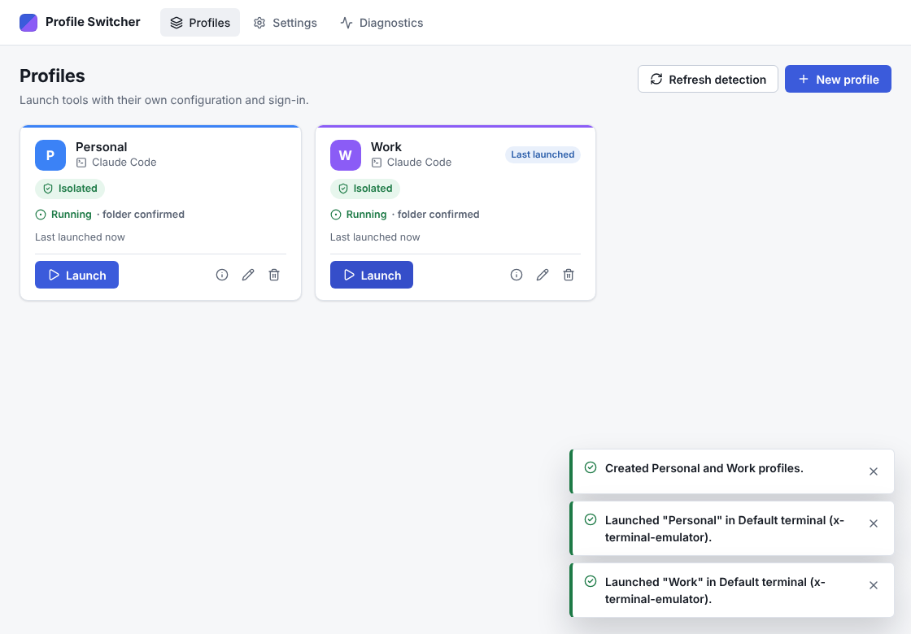
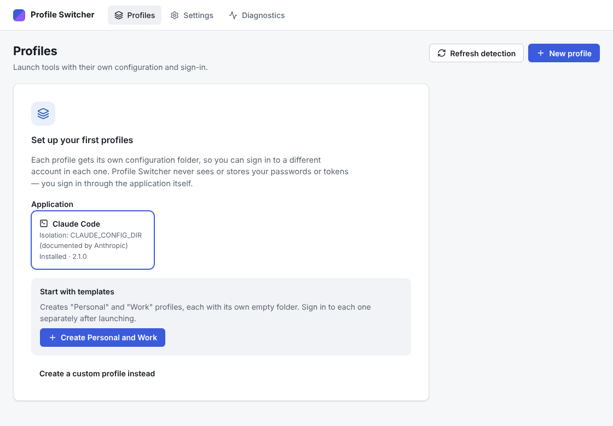
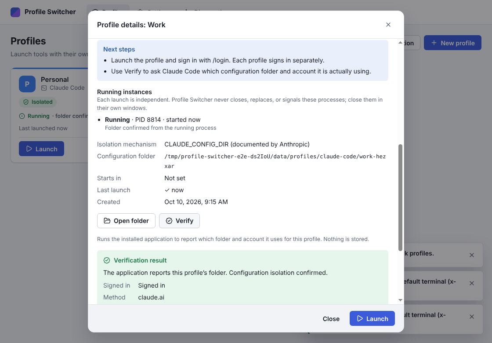

# Profile Switcher

A cross-platform desktop app to switch between isolated profiles for AI coding
tools and developer applications.

Keep a **Personal** and a **Work** Claude Code account signed in at the same
time, each with its own settings, history, and sign-in — and launch either one,
or both side by side, with one click. Everything stays on your computer.



> Screenshots are captured by the automated end-to-end test on Linux, which uses
> a stand-in Claude Code executable; folder paths in them are temporary test
> folders.

## Contents

- [What it does](#what-it-does)
- [Supported applications and systems](#supported-applications-and-systems)
- [Configuration isolation vs. account isolation](#configuration-isolation-vs-account-isolation)
- [Install](#install)
- [Using Profile Switcher](#using-profile-switcher)
- [Local data](#local-data)
- [Security model](#security-model)
- [Development](#development)
- [Testing](#testing)
- [Building and releasing](#building-and-releasing)
- [Troubleshooting](#troubleshooting)
- [Known limitations](#known-limitations)
- [Contributing and license](#contributing-and-license)

## What it does

- **Profiles with their own configuration folder.** For Claude Code, each
  profile runs with its own `CLAUDE_CONFIG_DIR`, the mechanism Anthropic
  documents for staying signed in to several accounts.
- **Run profiles concurrently.** Launch Personal, then Work, without closing
  Personal. Each launch is independent; Profile Switcher never closes,
  replaces, or signals a running profile.
- **Honest status.** Every profile shows whether isolation is supported,
  needs verification, or is unsupported — computed from what is actually
  installed — plus what is and is not guaranteed. A profile is shown as
  _Running_ only when its process is confirmed alive and identified.
- **Verify.** Ask the installed Claude Code which folder and account a profile
  is really using.
- **Credential hygiene.** Variables such as `ANTHROPIC_API_KEY` that would
  override a profile's sign-in are removed from launched profiles by default.
  Profile Switcher never stores passwords, tokens, or cookies.
- **Local-first.** No account, backend, telemetry, analytics, or cloud sync.

<p>
  
  
</p>

## Supported applications and systems

| Application    | macOS (arm64, x64)            | Windows x64                   | Linux x64                     |
| -------------- | ----------------------------- | ----------------------------- | ----------------------------- |
| Claude Code    | Isolated, concurrent profiles | Isolated, concurrent profiles | Isolated, concurrent profiles |
| Claude Desktop | Shared launch only            | Shared launch only            | Not available                 |

- **Claude Code** isolation uses Anthropic's documented `CLAUDE_CONFIG_DIR`.
  With Claude Code 2.1.296 on Linux, this project confirmed that the CLI
  resolves each profile's own folder, and automated tests confirm concurrent
  profiles with stand-in executables. Signing in to two real accounts at once,
  and macOS/Windows on real devices, are not yet verified by this project (see
  the [manual test plan](docs/manual-test-plan.md)).
- **Claude Desktop** has no documented way to run separate accounts or
  concurrent instances, so Profile Switcher does not attempt it. It offers a
  clearly labeled **Open (shared)** action that opens the app normally.

Details, evidence, and what is not guaranteed: **[docs/compatibility.md](docs/compatibility.md)**.
Future integrations (Codex CLI, Gemini CLI, Cursor, …) plug into the same
adapter interface; see [docs/architecture.md](docs/architecture.md).

## Configuration isolation vs. account isolation

Profile Switcher provides **configuration isolation**: each profile has its own
folder for the application's settings, history, and stored sign-in. **Which
account** you use is decided by the application: you sign in with its normal
flow (for Claude Code, `/login` inside the profile).

A separate profile does not create a separate subscription. Plans, usage
limits, organization policies, and entitlements are controlled by the target
application and the account you sign in with — not by Profile Switcher.

## Install

Download the installer for your system from the
[Releases page](https://github.com/FazelMan/profile-switcher/releases) and
check it against `SHA256SUMS.txt`.

| System  | File                                                                                         | Notes                                                                                                                                                |
| ------- | -------------------------------------------------------------------------------------------- | ---------------------------------------------------------------------------------------------------------------------------------------------------- |
| macOS   | `profile-switcher-<version>-mac-arm64.dmg` (Apple Silicon) or `-mac-x64.dmg` (Intel)         | Unless the release notes say it is notarized, macOS will warn on first launch: right-click the app → **Open**.                                       |
| Windows | `profile-switcher-<version>-win-x64-setup.exe`                                               | Unless the release notes say it is signed, SmartScreen will warn: **More info → Run anyway**.                                                        |
| Linux   | `profile-switcher-<version>-linux-x86_64.AppImage` or `profile-switcher_<version>_amd64.deb` | AppImage: `chmod +x` and run (needs FUSE, or run with `--appimage-extract-and-run`). DEB: `sudo apt install ./profile-switcher_<version>_amd64.deb`. |

Each release states its signing and notarization status explicitly.

You also need the application you want to launch, for example
[Claude Code](https://code.claude.com/docs/en/setup).

## Using Profile Switcher

1. **First run:** choose Claude Code and click **Create Personal and Work**, or
   create a custom profile.
2. **Launch** a profile. A terminal window opens running Claude Code with that
   profile's folder. Run `/login` and sign in with the account for that
   profile. You only need to do this once per profile.
3. **Launch another profile** at any time; both keep running.
4. **Details** shows the profile's folder, what is guaranteed, what is not,
   running instances, and **Verify**.
5. **Copy command** gives you a command to paste into your own terminal
   (bash/zsh, fish, PowerShell, or Command Prompt).

Profile options:

- **Configuration folder:** managed by Profile Switcher (recommended), a folder
  you choose (must not overlap another profile; non-empty folders need
  confirmation), or the application's default configuration (not isolated).
  The folder cannot be changed later, because that would change which sign-in
  the profile uses.
- **Start in folder:** the terminal's working directory.
- **Advanced → Pass credential environment variables through:** off by
  default; when on, the profile is marked _Needs verification_.

Deleting a profile removes it from Profile Switcher only. Its folder — and any
sign-in stored there — stays on disk, and the confirmation shows where.

Settings: theme (system/light/dark), language (English; more can be
contributed), primary action for command-line apps (open terminal or copy
command), preferred terminal, application detection, and version/license
information.

## Local data

| What                      | macOS                                                          | Windows                                     | Linux                                       |
| ------------------------- | -------------------------------------------------------------- | ------------------------------------------- | ------------------------------------------- |
| Profile list and settings | `~/Library/Application Support/Profile Switcher/metadata.json` | `%APPDATA%\Profile Switcher\metadata.json`  | `~/.config/profile-switcher/metadata.json`  |
| Managed profile folders   | `~/Library/Application Support/Profile Switcher/profiles/`     | `%LOCALAPPDATA%\Profile Switcher\profiles\` | `~/.local/share/profile-switcher/profiles/` |
| Launch records            | `~/Library/Application Support/Profile Switcher/run/`          | `%LOCALAPPDATA%\Profile Switcher\run\`      | `~/.local/state/profile-switcher/run/`      |
| Logs                      | `~/Library/Logs/Profile Switcher/`                             | `%LOCALAPPDATA%\Profile Switcher\logs\`     | `~/.local/state/profile-switcher/logs/`     |

Linux paths follow `XDG_CONFIG_HOME`, `XDG_DATA_HOME`, and `XDG_STATE_HOME`
when set. Setting `PROFILE_SWITCHER_DATA_DIR` to an absolute path puts
everything under that folder (useful for portable setups and testing).

Profile folders hold the target application's own files, including its stored
sign-in. Treat them like your normal `~/.claude` folder. Logs and the profile
list contain no credentials; logs do contain profile IDs, which are derived
from profile names.

## Security model

- The UI runs in a sandboxed, context-isolated renderer with no Node access and
  a strict Content Security Policy. It cannot navigate away or open windows.
- The renderer can only call a fixed set of operations. Every call is checked
  to come from Profile Switcher's own window and validated against a schema in
  the main process.
- Applications are started without a shell, from argument vectors. Profile
  names and descriptions are never part of a command. On Linux, launched
  processes inherit no Profile Switcher file descriptors.
- Profile Switcher never reads credential stores, keychains, browser data, or
  application databases, and never copies sign-in data between profiles.
- External links are limited to a fixed allow-list of HTTPS URLs.
- Logs and diagnostics are local and redacted (home folder, tokens, API keys,
  e-mail addresses); environment variables are reported by name only.

Report vulnerabilities privately: see [SECURITY.md](SECURITY.md).

## Development

Requirements: Node.js 22.12+ (24 recommended, see `.nvmrc`) and npm.

```bash
git clone https://github.com/FazelMan/profile-switcher.git
cd profile-switcher
npm ci
npm run dev        # starts Electron with hot reload
```

When running as root (for example in some containers), Chromium needs
`--no-sandbox`: `npx electron-vite dev -- --no-sandbox`.

Project layout:

```
src/shared    platform-neutral types, schemas, IPC contract, identity
src/main      Electron main process: storage, adapters, launching, IPC
src/preload   the contextBridge API
src/renderer  React UI
tests/        unit, integration, component, e2e (Playwright)
docs/         architecture, compatibility, manual test plan
```

## Testing

```bash
npm run lint           # ESLint
npm run format:check   # Prettier
npm run typecheck      # TypeScript (strict)
npm test               # unit + integration + component (Vitest)
npm run test:e2e       # builds, then runs the Electron end-to-end test (Linux)
```

On a headless Linux machine run the end-to-end test under Xvfb:
`npm run build && xvfb-run -a npx playwright test`.

Automated tests never need real accounts: they use stand-in `claude` and
terminal executables (`tests/e2e/fixtures/bin`). Some integration tests start
real processes and run on Linux only. Real-application checks are in the
[manual test plan](docs/manual-test-plan.md).

## Building and releasing

```bash
npm run package:linux   # AppImage + DEB (on Linux)
npm run package:mac     # DMG for arm64 and x64 (on macOS)
npm run package:win     # NSIS installer for x64 (on Windows)
npm run package:dir     # unpacked app for the current OS
```

Artifacts are written to `release/<version>/`. Build each OS on that OS.

**Releasing:** update `version` in `package.json`, add a matching
`## [x.y.z]` section to `CHANGELOG.md`, commit, then tag and push:

```bash
git tag v0.1.0
git push origin v0.1.0
```

The [release workflow](.github/workflows/release.yml) validates the tag and
changelog, runs the full CI suite, builds on macOS, Windows, and Linux runners,
generates `SHA256SUMS.txt`, and publishes the GitHub Release with the changelog
section and the signing status of every artifact. Tags with a suffix such as
`v0.2.0-beta.1` are published as pre-releases. Nothing is published if any
step fails.

Optional signing secrets (Settings → Secrets and variables → Actions):

| Secret                                                     | Purpose                                             |
| ---------------------------------------------------------- | --------------------------------------------------- |
| `MAC_CSC_LINK`, `MAC_CSC_KEY_PASSWORD`                     | Developer ID Application certificate (.p12, base64) |
| `APPLE_ID`, `APPLE_APP_SPECIFIC_PASSWORD`, `APPLE_TEAM_ID` | Notarization                                        |
| `WIN_CSC_LINK`, `WIN_CSC_KEY_PASSWORD`                     | Windows code-signing certificate                    |

Without them, macOS builds are ad-hoc signed and not notarized, Windows
installers are unsigned, and the release notes say so.

## Troubleshooting

- **"Not installed" although Claude Code is installed.** Profile Switcher
  searches `PATH` and common locations (`~/.local/bin`, `/opt/homebrew/bin`,
  `/usr/local/bin`, npm global folders). Choose **Refresh detection** after
  installing. Diagnostics lists what was found.
- **"No terminal found" (Linux).** Install a terminal emulator or pick one in
  Settings → Terminal, or switch the primary action to **Copy command**.
- **"Needs verification."** Open Details: a credential or provider variable is
  active, or Claude Code's version could not be read. Use **Verify**.
- **A profile shows "Launched — not confirmed running".** The terminal opened
  but the process could not be identified (for example the terminal failed to
  run the command, or you closed it). Nothing is wrong with the profile.
- **Profile list damaged.** Profile Switcher restores the last backup
  automatically, keeps the damaged file next to it, and tells you. Profile
  folders are never touched.
- **"Changes are disabled."** The profile list was saved by a newer Profile
  Switcher. Update the app.
- **Bug reports:** Diagnostics → **Copy diagnostics** (no names, account
  details, or variable values are included).

## Known limitations

- Claude Desktop: no separate accounts or concurrent instances (no documented
  mechanism). Linux has no official Claude Desktop build.
- Claude Code Console sign-ins made without an API key are stored outside the
  configuration folder and are shared between profiles (Anthropic-documented).
- Project files (`.claude/`, `CLAUDE.md`) and organization-managed settings
  apply to all profiles.
- The running process's configuration folder can be read back only on Linux;
  on macOS and Windows it is set at launch and checked with **Verify**.
- npm-installed Claude Code on Windows (`claude.cmd`) is launched in a console
  window but its running state is not tracked.
- Microsoft Store installs of Claude Desktop are not detected.
- macOS and Windows have not yet been verified on real devices by this project
  (see [docs/compatibility.md](docs/compatibility.md)); Windows ARM64 and Linux
  ARM64 are not built.
- English is the only language so far.

## Contributing and license

Contributions are welcome — see [CONTRIBUTING.md](CONTRIBUTING.md). Release
history is in [CHANGELOG.md](CHANGELOG.md).

Released under the [MIT License](LICENSE). Profile Switcher is an independent
open-source project and is not affiliated with or endorsed by Anthropic.
"Claude" is a trademark of Anthropic and is used only to identify the
applications this tool can launch. The icon and artwork are original.
